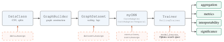

GraphToolbox
============

.. raw:: html

   

     

       
Graph neural network forecasting, one configuration at a time

       
GraphToolbox is a Python framework on PyTorch Geometric for forecasting
       time series observed on the nodes of a graph, such as regional electricity load. One
       configuration-driven pipeline covers graph construction, the choice among the convolution
       operators of PyTorch Geometric, training, reconciliation, expert aggregation, significance
       testing and interpretability, so that a benchmark changes one choice at a time.

       

         <a class="gt-btn" href="#installation">Install</a>
         <a class="gt-btn" href="#usage">Quickstart</a>
         <a class="gt-btn" href="_autosummary/graphtoolbox.html">API reference</a>
         <a class="gt-btn gt-btn-brown" href="https://github.com/EDF-Lab/GraphToolbox">GitHub</a>
         <a class="gt-btn gt-btn-brown" href="https://eloicampagne.fr">eloicampagne.fr</a>
       

     

   

How it works
------------

   Solid arrows carry data from raw series to forecasts and diagnostics. Dashed boxes are the
   configuration dictionaries of each stage, so that swapping the graph, the convolution or the
   training regime amounts to editing one field.

Features
--------

.. grid:: 1 2 2 2
   :gutter: 3

   .. grid-item-card:: Data and graphs
      :link: _autosummary/graphtoolbox.data
      :link-type: doc

      ``DataClass`` and ``GraphDataset`` build lagged, scaled node samples with train,
      validation and test splits. ``GraphBuilder`` derives the adjacency from coordinates or
      from the series (spatial distance, correlation, precision, GL3SR, dynamic time warping),
      any precomputed adjacency is loaded by name, and a graph can be selected on validation error.

   .. grid-item-card:: Models
      :link: _autosummary/graphtoolbox.models
      :link-type: doc

      ``myGNN`` runs 53 of the 65 convolutions of PyTorch Geometric through one adapter,
      ``TemporalGNN`` the recurrent cells of PyTorch Geometric Temporal, and
      ``AdditiveGraphModel`` an additive graph network whose forecast splits into
      feature-group contributions.

   .. grid-item-card:: Training
      :link: _autosummary/graphtoolbox.training
      :link-type: doc

      ``Trainer`` handles early stopping, forecasting metrics and MinT reconciliation,
      ``Optimizer`` runs Optuna searches over the model and the graph, and ``RollingTrainer``
      refits on rolling windows or updates a trained model every day.

   .. grid-item-card:: Reconciliation
      :link: _autosummary/graphtoolbox.training.reconciliation
      :link-type: doc

      MinT makes the node forecasts sum to a forecast of their total, fitted by the framework
      or supplied by the user, with a diagonal or a shrunk full error covariance.

   .. grid-item-card:: Expert aggregation
      :link: _autosummary/graphtoolbox.aggregation
      :link-type: doc

      Online aggregation (MLpol, EWA, BOA) across architectures or seeds, on the total or
      node by node, following the rules of the ``opera`` package.

   .. grid-item-card:: Evaluation
      :link: _autosummary/graphtoolbox.evaluation
      :link-type: doc

      Diebold-Mariano tests with Holm correction, moving-block bootstrap and Model Confidence
      Set, computed on cached forecasts.

   .. grid-item-card:: Interpretability
      :link: _autosummary/graphtoolbox.interpretability
      :link-type: doc

      Attention matched to edges, occlusion influence, accumulated local effects, and maps of
      edge attributions.

   .. grid-item-card:: Baselines
      :link: _autosummary/graphtoolbox.models.baseline
      :link-type: doc

      Reusable references for comparison: ARIMA-X, GAM fitted per forecast slot, an LSTM with
      covariates, XGBoost, Chronos-Bolt and Chronos-2.

Examples from the paper
-----------------------

The figures below come from the benchmark on French regional load and net-load of
`Campagne et al. (2026) <https://arxiv.org/abs/2609.24609>`_, run with GraphToolbox.

.. tab-set::

   .. tab-item:: Sweep

      .. figure:: _static/paper/load_sweep.svg
         :target: _static/paper/load_sweep.svg
         :alt: RMSE of the 46 operators of the load sweep
         :width: 100%

         National RMSE of the 46 operators of the load sweep on the 2019 test year, with
         block-bootstrap standard errors. Filled markers belong to the 90% Model Confidence Set.
         Built with ``myGNN``, ``Trainer`` and ``graphtoolbox.evaluation``.

   .. tab-item:: Aggregation

      .. figure:: _static/paper/aggregation.svg
         :target: _static/paper/aggregation.svg
         :alt: MLpol weights and cumulative RMSE over 2019
         :width: 100%

         Top, daily MLpol weights of the five operators with the largest average weight.
         Bottom, cumulative RMSE of MLpol, the uniform average and the best single operator.
         Built with ``graphtoolbox.aggregation.Aggregation``.

   .. tab-item:: By region

      .. figure:: _static/paper/regional_mixture.svg
         :target: _static/paper/regional_mixture.svg
         :alt: Experts with the largest MLpol weight in each French region
         :width: 80%

         MLpol run separately in each of the 12 regions: the three experts with the largest
         mean weight, the heaviest in bold and as the fill colour.

   .. tab-item:: Attention

      .. figure:: _static/paper/attention.svg
         :target: _static/paper/attention.svg
         :alt: Attention of GATv2 against occlusion influence on the French regions
         :width: 100%

         Attention of a GATv2 on the French regions, set against the occlusion influence of each
         neighbour on the forecast. Built with ``attention_by_snapshot``,
         ``occlusion_influence`` and ``neighbourhood_deviation``.

   .. tab-item:: Additive model

      .. figure:: _static/paper/ale.svg
         :target: _static/paper/ale.svg
         :alt: Feature-group contributions to the net-load forecast
         :width: 100%

         Contributions of the feature groups of an ``AdditiveGraphModel`` to the national
         net-load forecast during 4 to 10 February 2019. They sum to the forecast minus a
         constant baseline.

Installation
------------

Clone the repository and install the package and dependencies:

.. code-block:: bash

   git clone git@github.com:eloicampagne/GraphToolbox.git
   cd GraphToolbox
   pip install .

To unlock the full set of supported convolutions, install the optional PyTorch Geometric extensions that match your PyTorch and platform versions. Replace ``${TORCH}`` and ``${CUDA}`` with the appropriate values (e.g. ``2.5.1`` and ``cpu``):

.. code-block:: bash

   pip install torch-scatter torch-sparse torch-cluster torch-spline-conv \
       -f https://data.pyg.org/whl/torch-${TORCH}+${CUDA}.html

Without these packages, DynamicEdgeConv, GravNetConv, XConv, PANConv, and SplineConv are unavailable. FusedGATConv additionally requires ``dgNN``, which is not available on all platforms.

Convolutions
------------

GraphToolbox benchmarks the entire ``torch_geometric.nn.conv`` collection against ``myGNN``, evaluating whether each operator can be instantiated and run end-to-end with standard node-feature inputs and a homogeneous graph structure.

**Legend**

- |green| Working (fully compatible with ``myGNN``)
- |red| Skipped (requires the ``dgNN`` package, not available on all platforms)
- |white| Skipped (requires CUDA-specific dependencies or device-restricted libraries)

.. |green| unicode:: U+1F7E2
.. |red|   unicode:: U+1F534
.. |white| unicode:: U+26AA

.. list-table::
   :header-rows: 1
   :widths: 25 10 65

   * - Convolution Type
     - Status
     - Convolutions
   * - Propagation
     - |green|
     - SimpleConv, GCNConv, ChebConv, SGConv, SSGConv, APPNP, GCN2Conv, ARMAConv, TAGConv, LGConv, ClusterGCNConv, MixHopConv, PANConv
   * - Attention
     - |green|
     - GATConv, GATv2Conv, SuperGATConv, TransformerConv, AGNNConv, RGATConv, FAConv, DNAConv, GPSConv, PointTransformerConv
   * - Gating and modulation
     - |green|
     - GatedGraphConv, ResGatedGraphConv, FiLMConv
   * - Relational and edge-conditioned
     - |green|
     - RGCNConv, FastRGCNConv, NNConv, CGConv, GMMConv, SplineConv, FeaStConv, PDNConv, GINEConv
   * - Point-cloud and dynamic graphs
     - |green|
     - EdgeConv, DynamicEdgeConv, GravNetConv, XConv
   * - Other aggregators
     - |green|
     - SAGEConv, GraphConv, MFConv, LEConv, PNAConv, GENConv, EGConv, GINConv, GeneralConv, DirGNNConv, AntiSymmetricConv, SignedConv, WLConv, WLConvContinuous
   * - Missing optional deps
     - |red|
     - FusedGATConv (``dgNN``)
   * - Heterogeneous graphs
     - |white|
     - HANConv, HGTConv, HEATConv, HeteroConv
   * - Point-cloud
     - |white|
     - PointNetConv, PointGNNConv, PPFConv
   * - CuGraph (CUDA only)
     - |white|
     - CuGraphGATConv, CuGraphRGCNConv, CuGraphSAGEConv
   * - Hypergraph
     - |white|
     - HypergraphConv

.. list-table::
   :header-rows: 1
   :widths: 20 15 15

   * - Status
     - Count
     - Percentage
   * - |green|
     - **53**
     - **81.5 %**
   * - |red|
     - **1**
     - **1.5 %**
   * - |white|
     - **11**
     - **16.9 %**
   * - **Total Tested**
     - **65**
     - **100 %**

Counts follow ``torch_geometric.nn.conv.__all__`` in PyTorch Geometric 2.6.1; the aliases ECConv (NNConv) and PointConv (PointNetConv) are not counted twice.

FusedGATConv is not broken; it requires the ``dgNN`` package which is not available on all platforms.
Installing ``torch-cluster``, ``torch-sparse``, and ``torch-spline-conv`` unlocked DynamicEdgeConv, GravNetConv, XConv, PANConv, and SplineConv.

If you spot a missing convolution, find an incompatibility, or want to help extend support, contributions are warmly welcomed. Feel free to open an issue or submit a PR.

Usage
-----

A GATv2 forecasting the next 48 half-hours of regional load on the DTW graph, reconciled with a
national XGBoost forecast:

.. code-block:: python

   from torch_geometric.nn import GATv2Conv

   from graphtoolbox.data import DataClass, GraphDataset
   from graphtoolbox.models import myGNN
   from graphtoolbox.training import Trainer

   data_kwargs = {
       "node_var": "Region",                    # one node per region
       "features_to_lag": {"load": (1, 48)},    # load of the previous day
       "dummies": ["Instant", "JourSemaine"],   # one-hot calendar
       "day_inf_train": "2015-01-01", "day_sup_train": "2018-01-01",
       "day_inf_val": "2018-01-01", "day_sup_val": "2018-12-31",
       "day_inf_test": "2019-01-01", "day_sup_test": "2019-12-31",
   }
   dataset_kwargs = {
       "adj_matrix": "dtw",                     # graph read from graph_folder/dtw/
       "features_base": ["temp", "nebu", "wind", "Instant", "JourSemaine"]
                        + [f"load_l{t}" for t in range(1, 49)],
       "target_base": "load",
   }
   data = DataClass(path_train="train.csv", path_test="test.csv",
                    data_kwargs=data_kwargs, folder_config=".")
   common = dict(data=data, dataset_kwargs=dataset_kwargs, out_channels=48,
                 graph_folder="../graph_representations")
   train = GraphDataset(period="train", **common)
   scalers = dict(scalers_feat=train.scalers_feat, scalers_target=train.scalers_target)
   val, test = (GraphDataset(period=p, **scalers, **common) for p in ("val", "test"))

   model = myGNN(in_channels=train.num_node_features, num_layers=2, hidden_channels=64,
                 out_channels=48, conv_class=GATv2Conv)   # any PyG convolution
   trainer = Trainer(model=model, dataset_train=train, dataset_val=val, dataset_test=test,
                     batch_size=32, model_kwargs={"lr": 1e-3, "num_epochs": 300},
                     reconcile=True, top_level_model="xgb")
   pred, target, edge_index, edge_weight = trainer.train(patience=30, plot_loss=False)
   trainer.evaluate()

Reconciliation
--------------

MinT reconciliation makes the node forecasts sum to a forecast of their total,
weighting each series by its errors on held-out data. With ``reconcile=True``,
the ``Trainer`` fits a top-level model (``top_level_model="xgb"``, ``"ridge"``,
``"rf"`` or ``"gam"``) on the lags, the calendar and the national mean of the
covariates, or takes an external forecast through ``top_forecasts_val`` and
``top_forecasts_test``. ``reconcile_covariance="diag"`` (default) weights the
series by their validation error variances; ``"shrink"`` uses their full error
covariance, shrunk toward its diagonal with the Schafer-Strimmer intensity.

.. code-block:: python

   trainer = Trainer(model=model, dataset_train=graph_dataset_train,
                     dataset_val=graph_dataset_val, dataset_test=graph_dataset_test,
                     batch_size=16, reconcile=True, top_level_model="xgb",
                     reconcile_covariance="shrink")

Cached forecasts can be reconciled without a model:

.. code-block:: python

   from graphtoolbox.training.reconciliation import reconcile

   # base [nodes, T] and top [T] to reconcile; their errors on a validation period.
   coherent = reconcile(base, top, base_errors_val, top_errors_val, covariance="shrink")
   total = coherent[-1]          # coherent forecast of the total

Expert Aggregation
------------------

The ``graphtoolbox.aggregation`` module combines several competing forecasts
into a single one whose weights adapt over time, in the spirit of the ``opera``
package (Gaillard & Goude). It is useful for blending the GNN forecast with
external experts such as a top-level XGBoost or GAM model, either sequentially
(online) or as a static combiner fitted on a history.

The estimator consumes a matrix of expert forecasts of shape ``[T, K]`` (``T``
time steps, ``K`` experts) and the observations ``[T]``, and exposes the full
weight trajectory in ``weights_`` (handy for interpretability) as well as the
final convex weights in ``coefficients_`` for out-of-sample reuse.

.. code-block:: python

   import numpy as np
   from graphtoolbox.aggregation import Aggregation

   # Toy example: 4 experts of increasing noise around a signal.
   rng = np.random.default_rng(0)
   T, K = 1000, 4
   y = np.sin(np.linspace(0, 30, T)) + 0.5 * np.linspace(0, 1, T)
   experts = y[:, None] + rng.normal(0, [0.1, 0.3, 0.6, 1.0], size=(T, K))

   # MLpol is parameter-free and a robust default.
   agg = Aggregation(model="MLpol", loss="square").run(experts, y)

   print(agg.summary())          # aggregated vs best/mean expert loss
   forecast = agg.prediction_    # aggregated forecast, shape [T]
   weight_path = agg.weights_    # weight trajectory, shape [T, K]

   # EWA and BOA take a learning rate, auto-calibrated when y is given.
   ewa = Aggregation(model="EWA").run(experts, y)
   print("calibrated eta:", ewa.learning_rate_)

Fit on a history and reuse the learned static weights on unseen experts:

.. code-block:: python

   agg = Aggregation(model="MLpol").run(experts[:800], y[:800])
   future = agg.predict(experts[800:])   # applies agg.coefficients_

For a genuine streaming setting, alternate ``partial_fit`` (to obtain the
forecast for the current step) and ``update`` (to feed back the observation):

.. code-block:: python

   agg = Aggregation(model="BOA", learning_rate=1.0).reset(n_experts=K)
   preds = []
   for t in range(T):
       preds.append(agg.partial_fit(experts[t]))  # forecast at time t
       agg.update(y[t])                            # reveal observation

When forecasts are served in batches rather than one step at a time, use
``block_size``, which follows ``opera``'s ``predict`` / ``update`` split. A
day-ahead forecast delivered as daily blocks of 48 half-hours commits each
block with the weights known at its start; once the block is observed the
weights then advance step by step within it before the next block:

.. code-block:: python

   agg = Aggregation(model="MLpol").run(experts, y, block_size=48)

Available rules are ``"MLpol"`` (default, parameter-free), ``"EWA"`` and
``"BOA"`` (adaptive, learning-rate based), plus the ``"uniform"`` mean and the
``"best"`` single-expert oracle as baselines.

Baselines and interpretability
------------------------------

Classical forecasting baselines are reusable from ``graphtoolbox.models.baseline``:
per-slot ARIMA-X and GAM fitting, the covariate-conditioned LSTM, XGBoost,
Chronos-Bolt and Chronos-2. Dataset assembly, the paper-specific formulas, and the
pooled and per-node XGBoost and MLP baselines of the paper remain in ``examples``.

``graphtoolbox.interpretability`` exposes the attribution tools:
``attention_by_snapshot`` returns the attention of every layer and snapshot,
matched to edges; ``occlusion_influence`` measures the change of a node's
forecast when the inputs of another node are replaced by a baseline;
``neighbourhood_deviation`` and ``sender_variance_share`` summarize them;
``additive_ale_from_dataset`` computes accumulated local effects through an
``AdditiveGraphModel``; ``compute_edge_masks`` runs GNNExplainer; and
``plot_ale_group_importance`` renders grouped ALE diagnostics. The complete reproduction commands and cached
output locations are listed in the `reproducibility guide`_.

.. _reproducibility guide: https://github.com/eloicampagne/GraphToolbox/blob/main/examples/REPRODUCIBILITY.md

Changelog
---------

Release notes are maintained in the project `changelog`_.

.. _changelog: https://github.com/eloicampagne/GraphToolbox/blob/main/CHANGELOG.md

Contributing
------------

Contributions are welcome! Please fork the repository and submit a pull request.

Special thanks to all contributors of the GraphToolbox project:

- Eloi Campagne
- Itai Zehavi

License
-------

This project is licensed under the GPL License - see the ``LICENSE`` file for details.

Documentation
-------------

.. autosummary::
   :toctree: _autosummary
   :recursive:

   graphtoolbox
